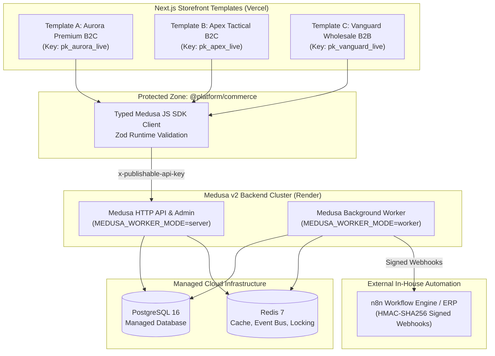

# System Architecture

## 1. Architectural Philosophy & Zero Custom Plumbing
The platform replaces monolithic multi-brand e-commerce with a decoupled, headless topology:
- **Single Source of Truth**: ONE Medusa v2 backend instance handles all commerce logic (carts, checkout, payments, inventory, taxes, customer sessions, promotions).
- **Native Extensibility**: Core commerce uses strictly native Medusa v2 modules, core flows, and Store/Admin APIs. Custom backend code is strictly constrained to subscribers (webhooks), workflows, scheduled jobs, and seed scripts.
- **Multi-Tenancy via Sales Channels**: Brands are isolated logically at the database level using native Medusa v2 Sales Channels and Publishable API Keys. Storefronts ship only their brand's publishable key.



---

## 2. Multi-Tenancy & Channel Isolation
1. **Sales Channel Binding**:
   - Each brand corresponds to exactly one `SalesChannel`.
   - Each `SalesChannel` is associated with one `PublishableApiKey`.
2. **Channel Scoping Invariants**:
   - Products are linked to specific sales channels.
   - When a storefront passes `x-publishable-api-key: pk_brand`, Medusa automatically restricts `/store/products` and `/store/carts` to the linked channel.
   - Cross-channel access (e.g. attempting to fetch a B2B product using a B2C key) returns `404 Not Found`.
   - Adding a variant from Channel Y into a cart under Channel X returns `400 Bad Request`.

---

## 3. Server vs. Worker Mode Execution
In high-concurrency production deployments on Render, backend instances are decoupled:
- **`MEDUSA_WORKER_MODE=server`**:
  - Handles incoming HTTP requests for Admin and Store APIs.
  - Does NOT execute background scheduled tasks or heavy subscriber workflows.
- **`MEDUSA_WORKER_MODE=worker`**:
  - Does not open an HTTP listening port.
  - Consumes Redis event-bus queues, executes long-running workflows, and manages outbound webhook retries.
- **Distributed Coordination**:
  - `@medusajs/event-bus-redis` for distributed pub/sub.
  - `@medusajs/cache-redis` for shared query caching.
  - `@medusajs/workflow-engine-redis` and `@medusajs/locking-redis` to prevent duplicate workflow executions and race conditions.

---

## 4. Protected vs. Safe Boundaries
```text
apps/storefront-*/src/sections/ (SAFE)
       │ (uses)
       ▼
packages/ui/ (SAFE)
       │ (uses)
       ▼
packages/theme/ (SAFE)
       ▲
       │ (configures)
brands/<slug>/theme.config.json (SAFE)

─────────────────── BOUNDARY GUARD ───────────────────

packages/commerce/ (PROTECTED)
       │ (uses)
       ▼
Medusa JS SDK v2 Store API
```
- Safe marketing components only receive clean, Zod-validated data props.
- No direct database connections or administrative endpoints are ever exposed to the client browser.
