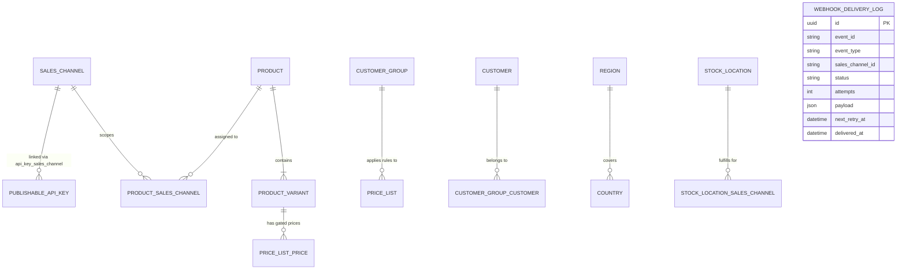

# Database Architecture & Migration Management

## 1. Engine & Connectivity
- **Engine**: Managed PostgreSQL 16 (Render / Docker Compose)
- **Connection Pooling**: Managed via Medusa v2 Knex/MikroORM database pool with bounded min/max connection limits:
  - `min`: 2 connections per instance
  - `max`: 20 connections per instance
- **SSL**: Enforced in production (`ssl: { rejectUnauthorized: true }`).

---

## 2. Core Entities & Relationships

---

## 3. Webhook Delivery Log Schema (`webhook_delivery_log`)
Persisted via the custom Medusa DML module in `apps/medusa/src/modules/webhook-log`:
- `id`: Primary key (UUID)
- `event_id`: Unique identifier of the business event (UUID)
- `event_type`: Domain event name (e.g. `order.placed`, `payment.captured`)
- `sales_channel_id`: Tenant channel ID (nullable)
- `brand_slug`: Tenant brand identifier
- `endpoint_url`: Target receiver URL
- `status`: State enum (`pending`, `delivered`, `failed`, `dead_letter`)
- `attempts`: Number of retry attempts made
- `max_attempts`: Retry threshold (default: 5)
- `response_status`: Last HTTP response code received
- `response_body`: Truncated HTTP response body for debugging
- `error_message`: Error message if network exception occurred
- `payload`: Full JSON envelope dispatched
- `next_retry_at`: Scheduled timestamp for next retry attempt
- `delivered_at`: Timestamp of successful 2xx delivery

---

## 4. Migration Strategy & Zero-Downtime Deploys
1. **Pre-Deploy Migration Execution**:
   Render executes `pnpm --filter medusa medusa db:migrate` as the `preDeployCommand` before starting new application containers.
2. **Expand-and-Contract Rule**:
   - Column additions, table additions, and new indexes are additive (non-breaking).
   - Column deletions or renaming must use a multi-stage migration where old columns are deprecated first before deletion.
3. **Rollback & Roll-forward**:
   - In case of a migration failure during deployment, Render aborts the deploy, leaving existing containers running safely.
   - Database restore drills are documented in `DEPLOYMENT.md`.
